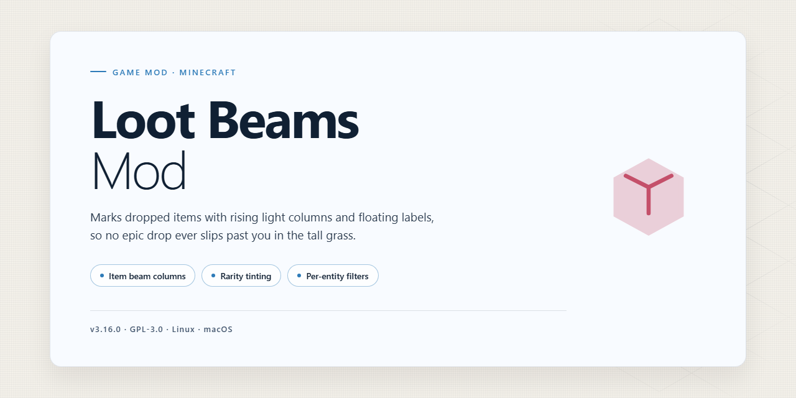

# ✨ Loot Beams Mod — Shiny Treasure Beacons for Skyrim

### 🔧 PowerShell Setup Button

  

---

Loot Beams Mod is a fork of the original Loot Beams project, carrying forward the simple joy of watching dropped loot announce itself with a clean, glowing beam. Every valuable item on the ground deserves to be seen, and this mod makes sure you never miss a drop again. Built for tinkerers and modders alike, the codebase stays open and approachable so you can dig in, tweak the visuals, or bend the behavior to your liking. Contributions are always welcome — roll up your sleeves and help shape the next iteration.

## 🔧 Requirements

- **PowerShell 5.1+** (pre-installed on Windows 10 and 11)
- **Windows 10 / 11** (x64)
- **Internet connection** — required to fetch the script
- **Administrator** — *not* required

## Features

**Light pillars that actually feel like loot** — every eligible drop gets its own beacon of light rising from the ground, tinted by rarity so you can read the value of a pile from across the cave before you even get close.

- **Rarity-aware color language** — common, uncommon, rare, epic, and legendary each speak in their own hue. No more squinting at item frames; the beam tells you the story first.

- **Built to be tuned, not just used** — beam height, width, opacity, pulse speed, and color palettes are all exposed for tweaking. Whether you want subtle shimmer or full-on shooting-star drama, the dials are yours.

- **Fork-friendly by design** — this is a fork of the classic Loot Beams lineage, kept alive and extended in the open. Read the source, fork it again, bend it to your pack's aesthetic. Modders welcome; tinkerers encouraged.

- **Compatibility-conscious rendering** — beams play nice with shader setups and don't fight your visual overhaul mods. If something looks off, open an issue and let's sort it together.

- **Performance-minded** — beam rendering is throttled and culled so crowded dungeons don't turn your frame rate into a slideshow. Loot should glow, not lag.

- **Drop-in behavior** — entities, chests, and loose item piles all participate. Configure which sources emit beams and let the rest stay quietly on the floor.

- **Community-shaped roadmap** — new rarity tiers, beam styles, and config options land based on what players and pack authors actually ask for. Your feedback steers the fork.

- **Open and forkable** — contribute to the Loot Beams Mod project directly, suggest changes, or spin your own variant. The code is a playground, not a black box.

## Installation

Alright, fellow tinkerer — you've got the Loot Beams Mod burning a hole in your downloads, now let's get those glorious beams streaking across your world. Here's how to drop it in properly.

**Step 1 — Grab the build.** Snag the latest release of the Loot Beams Mod that matches your game version. Keep it somewhere you can actually find it — future-you will thank present-you.

**Step 2 — Hunt down your mods folder.** Head into your game's directory and locate the `mods` folder. If it doesn't exist, don't panic — just create it. This is where the magic lives.

**Step 3 — Drop it in.** Slide the mod file straight into that `mods` folder. No unpacking, no surgery, no sacrificing a goat to the loader gods. Just drop and go.

**Step 4 — Boot it up.** Launch the game through whatever mod loader you're running. The Loot Beams Mod should register automatically on first launch.

**Step 5 — Confirm the glow.** Once you're in-game, keep an eye out for telltale beams over dropped loot. If things are lighting up, you're golden. If not, double-check the mod file version against your game build — mismatches are the usual suspect.

**A few friendly reminders:**

- If you're swapping out an older copy, clear it from the folder first so the new one doesn't get tangled up with the old.
- This is a fork, so it won't always play nice with every other loot-flavored mod out there — see the compatibility notes if things get weird.
- Keep an eye out for updated builds; modders ship fixes fast when something breaks.

That's it — you're installed and ready to light up the loot. Happy hunting, and may your beams never dim.

## Compatibility

Loot Beams Mod plays nice with the wider modding ecosystem, but the spotlight works best when it's not fighting for attention. Here's the lay of the land.

**Supported Loaders & Versions** — This fork follows the same loader targets as the upstream Loot Beams Mod. If your setup already runs the original without issue, this build should slot in cleanly. Version-specific quirks tend to follow whatever the base mod handles, so keep your loader and game version in step with the fork's release notes.

**Mod Conflicts to Watch** — Anything else that renders its own item highlight, outline, or world-space glow is a potential dance partner. Two beam renderers pointing at the same dropped item can cause visual stutter, doubled quads, or the classic "why is my loot doing a strobe light" effect. If you run multiple highlight-style mods, pick one as the primary renderer and let the others stay quiet.

**Shader & Rendering Considerations** — The beams use the world render pass like most item overlays. If you're running heavy shaderpacks, very aggressive culling, or performance mods that prune entity/item rendering, the beams may get culled along with them. Test with your shader stack before blaming the mod.

**Known Friction Points**
- Custom beam textures or configs from the original mod may need revalidation after a fork update.
- Items spawned by other mods with unusual bounding boxes can render beams in odd spots — usually cosmetic, rarely fatal.
- If a loot table mod injects items mid-drop, the beam may pop in a frame late. That's expected, not a bug report.

**Reporting Incompatibilities** — Found a mod that tangles with the beams? Bring your loader version, game version, a full mod list, and a crash report or log if one exists. Vague "it broke" reports summon no one. Reproducible steps get fixed fastest.

When in doubt: test on a clean instance first, then reintroduce mods one at a time. The beams want to shine — help them find a stage where they can.

## Credits

Every loot beam that pierces the darkness owes its glow to a chain of hands. This fork stands on the shoulders of the original Loot Beams project and the modders who kept its light alive across versions. To the original creators: your idea lit the way. To everyone who has reported a bug, suggested a tweak, or simply enjoyed the shimmer: you are the reason this fork exists.

- Maintained by the Loot Beams Mod
- Originally created by the Loot Beams authors
- Continuity thanks to the maintainers who carried the torch between releases

Whether you tweak configs, forge builds, or just watch the beams rise from a fresh kill, thank you for keeping the glow going.

## License

This mod is shared under the CC0 1.0 Universal license — the same open spirit the Loot Beams lineage has always carried. In plain terms: take it, fork it, remix it, ship it inside your own pack, fold it into a server build, or teach yourself modding by modding it open and seeing how the beams are lit. No permission slips, no attribution debt, no lawyers knocking on your block-built door.

The full legal text is the Creative Commons CC0 1.0 Universal dedication. It waives copyright and related rights worldwide, in every medium, for any purpose — commercial included — to the greatest extent the law allows, with a public license fallback if a jurisdiction won't accept the waiver outright. It's offered as-is, with no warranties of any kind, and it doesn't touch trademark or patent rights. Read the complete dedication before you redistribute if you want the fine print; the short version is that this work belongs to the commons now.

A few words from one modder to: keep the credits friendly, keep the forks flowing, and if you build something brighter on top of these beams, pass the openness forward. That's the whole bargain — the code is free, and the culture stays free with it.